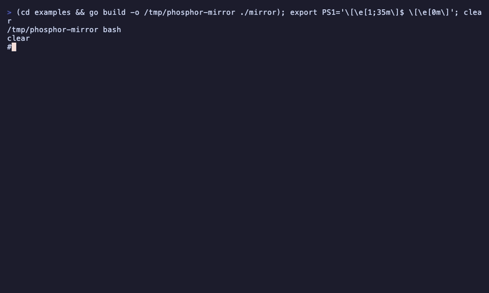
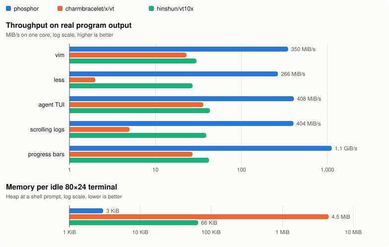

# phosphor



A headless VT/xterm terminal emulator for Go. Write a program's output to
it, read back what a terminal would show: text, colors, attributes,
hyperlinks, cursor, modes, title and scrollback. It answers the queries
programs send, tells a renderer which rows changed, reflows on resize, and
exports ANSI bytes for attaching clients and exact snapshots for checkpoints.

```go
t := phosphor.New(80, 24)
t.Write(output)       // io.Writer
fmt.Println(t.Lines())
```

It is the emulator inside [ptyd](https://github.com/2018kguo/ptyd), a
daemon that keeps thousands of terminals alive, attaches clients to them
and checkpoints them to disk, which is why it is small and fast when idle
and why it has a separate exact checkpoint format.

## Why

- **Small.** About 2.5 KB for an idle 80x24 terminal at a shell prompt: a
  cell is 16 bytes, rows are allocated once drawn on, the alternate
  screen only while shown, and scrollback is kept serialized under a
  byte budget (an 80x24 terminal with 2,000 lines of log scrollback holds
  about 340 KB).
- **Correct.** Five external conformance suites run as ordinary Go tests,
  with no unexplained failures (table below). Every departure from a
  suite is listed with its reason, and a listed case that starts passing
  fails the build.
- **Fast.** 260-410 MiB/s per core on real program output (vim, less,
  an agent TUI, logs) and about 1 GiB/s on progress bars, 10-75x the
  throughput of `charmbracelet/x/vt` and `hinshun/vt10x` on the same
  streams, and redrawing a frame allocates nothing.
- **Checkpoints.** `Snapshot` preserves both screens, saved cursors,
  modes, colors, REP and unfinished input. `Repaint` draws a session
  into another terminal, with the limits under Serialization below.

The honest caveats: it does not encode input (keys, mouse, paste are the
caller's job; `Modes` says what the program asked for), it has no
graphics (sixel, kitty), and damage is per row with no scroll hints. If you
need a full terminal UI stack, `charmbracelet/x/vt` integrates with the
Charm ecosystem and does more around rendering and input; phosphor is the
screen model.

<picture>
  <source media="(prefers-color-scheme: dark)" srcset="docs/bench-dark.svg">
  
</picture>

The demo above is [`examples/mirror`](examples/mirror/main.go), about 150
lines: it runs a program in a PTY, writes its output to phosphor, and
draws the screen back from `Terminal.Cell` alone, redrawing only the rows
`RowDirty` reports. Try it with `cd examples && go run ./mirror vim`.

## Install

```sh
go get github.com/2018kguo/phosphor
```

Go 1.24 or later. Unicode 17 scalar widths are built in. Grapheme
boundaries use [uax29](https://github.com/clipperhouse/uax29).

## Use

```go
t := phosphor.New(80, 24,
	phosphor.WithScrollback(5000),     // lines (default 2000)
	phosphor.WithScrollbackBytes(1<<20), // memory budget (default 256 KiB)
	phosphor.WithReply(ptmx),          // answer queries to the program
)

t.Write(buf[:n])                      // as you read the PTY; sequences may be split

for y := range rows {
	for x := range cols {
		c := t.Cell(x, y)             // Rune, Combining, Width, Style, Link
		_ = c.Style.Fg.Kind()         // ColorDefault, ColorIndexed, ColorRGB
		_ = c.Style.Attrs&phosphor.AttrBold != 0
	}
}
t.Lines(); t.Line(y); t.Wrapped(y)    // text, soft wraps
t.ScrollbackLines(); t.ScrollbackLine(i); t.ScrollbackCells(i)
cur := t.Cursor()                     // X, Y, Visible, Shape, Blink, PendingWrap
m := t.Modes()                        // AltScreen, BracketedPaste, Mouse, KittyKeyboard...
t.Title()

t.Resize(120, 40)                     // reflows; also resize the PTY
snapshot := t.Snapshot()              // exact checkpoint, including geometry
var restored phosphor.Terminal
err := restored.RestoreSnapshot(snapshot, phosphor.SnapshotLimits{})
_ = err
attach := t.Repaint(true)             // ANSI for an attached terminal of the same size
_ = attach
```

`Style.UnderlineColor` stores the SGR 58 color; its default follows the
foreground. Hyperlinks and underline colors share a table of up to 65535
live pairs. Unused pairs are collected. If every entry is still live,
setting a new pair keeps the current hyperlink and underline color until
space becomes available.

The [examples](https://pkg.go.dev/github.com/2018kguo/phosphor#pkg-examples)
show basic use, a headless runner answering queries, a renderer driven by
damage, attaching through `Repaint`, and `Restart`.

### Queries

Programs ask their terminal things and some wait for the answer: shells
and editors send DA1 and the kitty keyboard query at startup, prompts ask
for the cursor position, editors ask for the background color. With
`WithReply(w)` the terminal writes the answers to `w`, usually the PTY
master, during `Write`. Without it queries are ignored, which is right
when a real terminal downstream answers them.

Answered: DA1 (`CSI ? 62 ; 22 c`, a VT220 with ANSI color), DA2, DA3,
DSR 5 and 6 (CPR), DECXCPR, DSR ?15, ?26 and ?996 (dark or light, from the
background), DECRQM for ANSI and DEC modes, DECRQSS (SGR, DECSTBM,
DECSLRM, DECSCUSR, DECSCA, DECSCL), XTVERSION (`phosphor`), XTGETTCAP
(`Co`, `colors`), the kitty keyboard flags (`CSI ? u`), XTWINOPS 18 (text
area size), and OSC 4, 10, 11 and 12 color queries from the palette
(`WithPalette`, `Palette`). Programs can also set and reset those colors
(OSC 4, 10, 11, 12, 104, 110-112).

### Rendering

```go
for y := range rows {
	if t.RowDirty(y) {
		drawRow(y)
	}
}
t.ClearDirty()
```

A row is dirty when its cells may have changed since the last
`ClearDirty`: output, scrolling, erasing, switching screens, resizing, or
a palette or reverse-video change. Before the first `ClearDirty` every row
is dirty, and until then tracking costs nothing. The cursor is not part of
it; compare `Cursor()` with what you drew. `Modes().SyncUpdate` is set
while a program draws a frame it wants shown at once (mode 2026).
`Palette().Resolve(color, background)` turns a cell color into RGB.

Applications hosting many sessions can call `Compact()` after output
settles. It frees completely zeroed rows, unused Unicode and hyperlink
storage, and temporary buffers. Clusters visible on either screen and links
held by saved cursors remain live; unchanged live tables stay in place. It does so
without changing the screen, scrollback, input modes or unfinished parser
state. Later output can allocate rows again. It is an explicit idle-time
tradeoff; ordinary writes do not run it.

### Serialization

Use `Snapshot()` for persistence and `RestoreSnapshot(data, limits)` to
restore it into an existing or zero `Terminal`. The versioned binary format
preserves exact cells on both screens, all saved cursors, REP, palette base
and overrides, scrollback policy, damage and unfinished parser input.
`AppendSnapshot` reuses a buffer. Restore is atomic, copies its input and
retains only the receiver's reply writer and bell callback. It invokes
neither callback. Zero limits allow 64 MiB of decoded storage and four
million cells per screen; callers can choose other positive limits.
Malformed, unsupported-version and limit errors are distinguishable with
`errors.Is`. A snapshot is not terminal output.

`Repaint(withScrollback)` returns bytes that, written to a terminal of the
same size in its initial state (another `phosphor.Terminal`, or a real
one), reproduce this one: scrollback, both screens with their soft wraps,
tab stops, saved cursors and modes, margins, the cursor with its pending
wrap, pen, character sets and shape, input modes, and the title. It is
wrapped in a synchronized update and hides the cursor while painting.
An unfinished escape sequence or UTF-8 character is restored after the
painting, so later output continues it correctly. Controls which already
took effect inside a sequence are not repeated, and a synchronized update
in progress stays in progress. The continuation is reconstructed from the
parser's bounded state; normal output needs no additional tracking buffer.
Colors the program set with OSC 4/10/11/12 are left out, since replaying
them would change the receiving terminal's own colors.
`AppendRepaint` reuses a buffer.

The preceding character used by REP (`CSI b`) is not serialized. Resuming
a pending REP after a repaint can therefore differ from uninterrupted
output; preserving unfinished parser input does not remove that limit.
With origin mode enabled, repaint clamps the live cursor to the scrolling
region. A restored cursor or scroll-and-clear (`CSI 22 J`) can leave it
outside that region, so the next printed character can move after repaint.
Also, scalar ANSI output cannot always replay an emoji narrowed by VS15
at the right edge of a one- or two-column screen after reflow. These are
portable ANSI export limits; exact snapshots preserve those states.

### Unicode

Mode 2027 (`CSI ? 2027 h`) enables streaming grapheme clustering, including
emoji sequences, flags, skin tones, Hangul and variation selectors. It is
off initially, matching libghostty-vt. Clusters survive split writes,
history, resizing, compaction and exact snapshots. Each cell retains at
most 32 UTF-8 bytes of text; longer clusters are truncated at that bound.
`CodepointWidth` reports a scalar's Unicode 17 terminal width (0, 1 or 2).
It does not measure the width of a grapheme by summing its parts.

`Restart()` is for running a new program in the same terminal: it resets
everything as RIS does but keeps the scrollback and the old screen in
view above the cursor, as a terminal that relaunches its command does.

### Concurrency

A `Terminal` is not safe for concurrent use. If one goroutine writes
output while another reads the screen, hold a lock around both. The reply
writer and bell callback run inside `Write` and must not call back into
the `Terminal`.

## What it models

- Printing: UTF-8 (invalid input becomes U+FFFD; C1 controls sent as
  UTF-8 act as their ESC forms), wcwidth widths (East Asian ambiguous =
  1), wide characters and the blank they leave at a wrap, combining marks,
  ZWJ and variation selectors kept with the previous character, DEC
  special graphics in G0-G3 with SI/SO, LS2/LS3, SS2/SS3, REP, insert
  mode, autowrap with xterm's pending-wrap rules, reverse wraparound (45,
  1045).
- Cursor: CUU/CUD/CUF/CUB, CNL/CPL, CHA/HPA/HPR, VPA/VPR, CUP/HVP, origin
  mode, DECSC/DECRC, SCOSC/SCORC, 1048, IND/RI/NEL, HT/CHT/CBT with
  HTS/TBC, DECSCUSR, independent cursor blinking (mode 12).
- Editing: ICH/DCH/ECH, IL/DL, SU/SD, ED/EL with the current background
  (BCE), ED 3, scroll-and-clear (ED 22), DECALN, character protection
  (DECSCA, SPA/EPA) with DECSED/DECSEL.
- Regions: DECSTBM, and DECLRMM/DECSLRM left and right margins with every
  operation they constrain.
- Screens: alternate screen modes 47, 1047, 1049; scrollback fed from the
  top of the main screen, stored as logical lines.
- Modes: DECAWM, IRM, LNM, DECOM, DECTCEM, DECCKM, DECKPAM, DECSCNM,
  mouse tracking and encodings, focus events, bracketed paste,
  synchronized update, grapheme clustering, kitty keyboard flags, XTSAVE/XTRESTORE.
- SGR: bold, faint, italic, underline styles (single, double, curly,
  dotted, dashed), blink, inverse, hidden, strikethrough, overline,
  16/256/RGB colors in the `;` and `:` forms, underline color (58/59).
- OSC: title (0, 2), hyperlinks (8), colors (4, 10, 11, 12, 104, 110-112).
- Resize: the main screen reflows (narrowing and widening back is exact)
  and lines come back from the scrollback when it grows.
- RIS, DECSTR.

## What it does not

- Input encoding (keys, mouse reports, paste): the caller writes those to
  the PTY, using `Modes`.
- Double-width and double-height lines, rectangular area operations
  (DECCRA, DECERA, DECFRA, DECIC...), 132-column mode (DECCOLM),
  national character sets, SGR fonts and super/subscript.
- Sixel and kitty graphics, OSC 52 (clipboard), OSC 7 and 133 (shell
  integration), icon names, the title stack.
- 8-bit C1 controls outside UTF-8, and S8C1T replies.
- The alternate screen is cut or padded on resize, not reflowed
  (full-screen programs redraw on SIGWINCH).

## Conformance

Five external suites run as ordinary Go tests (`VT_CONF_REPORT=1 go test
-run 'Conformance|Libvterm|Alacritty' -v` prints the table).

| Suite | How | Pass | Fail | Deliberate difference | Out of scope |
|---|---|---|---|---|---|
| libvterm `t/*.test` | scripts run unchanged by an interpreter, replies included | 731 | 0 | 26 | 195 |
| ghostty `Terminal.zig`, `stream_terminal.zig` | translated cases | 502 | 0 | 5 | 42 |
| wezterm `term/src/test` | translated cases | 128 | 0 | 6 | 4 |
| esctest2 (xterm) | independently written cases (the GPL source is not used) | 410 | 0 | 12 | 215 |
| alacritty ref tests | recordings and reference grids, per line | 1507 / 1557 lines, 37 / 45 tests | 0 | 8 tests | |

"Deliberate difference" cases are listed with a reason in
`conformance_known_test.go`: places where that emulator departs from
xterm (wezterm lets the cursor column equal the width, alacritty ignores
SGR 21 and keeps a pending wrap across EL, libvterm brightens bold colors
in the pen and answers DA1 as a VT100), places where the upstream harness
fakes state, and the few gaps in the list above. "Out of scope" counts
cases for features listed as not modeled, mostly input encoding,
graphics-adjacent and window operations, palette rendering and rectangular
operations. Query replies are checked by the
libvterm scripts and by `TestReplies`.

Besides the suites:

- Fuzzers: `FuzzTokens` (an alphabet of the sequences programs use, plus
  resizes, with invariants after every step and an exact `Repaint` round
  trip), `FuzzRepaintContinuation` (prefix, repaint and continued output),
  `FuzzStream` (raw bytes and resizes), `FuzzChunking` (how output
  is split into writes does not matter), `FuzzWrite`, `FuzzDamage` (every
  row whose cells changed is dirty), `FuzzReplies` (answering queries
  never changes the state), `FuzzGraphemeTransitions` (clustering, mode
  changes and reflow), `FuzzRestoreSnapshot` (malformed binary data and
  atomic failure), `FuzzSnapshotContinuation` (exact restore followed by
  continued output), and, in the `oracle` module, `FuzzOracle`, a
  differential fuzzer against `charmbracelet/x/vt` on the subset where it
  agrees with xterm. CI runs each for 30 seconds. Before
  the extraction the targets had about 2.3 hours of fuzzing; since, each
  has run 4-5 minutes on 8 workers (which found one Repaint bug, now a
  regression input).
- Recordings of nvim, vim, less, nano and man, cut at 40 points: the
  invariants, the `Repaint` round trip and resizes at each.
- Every byte boundary in those recordings: repaint and continue the next
  32 bytes before a later redraw can hide parser corruption. Focused cases
  also check styles, modes, replies, bells, oversized sequences and every
  parser state.
- `TestRedrawDoesNotAllocate` pins zero allocations per redraw frame,
  `TestDamageDoesNotAllocate` the same with damage tracking on, and
  `TestCellDoesNotAllocate` reading every cell.

## Performance

The [Unicode and exact-checkpoint comparison](oracle/ghostty/results/2026-10-27-round3/README.md)
records the broader native compatibility corpus, Unicode audits, idle memory
and checkpoint costs. Passing those finite tests is not universal terminal
compatibility.

The [October 2026 follow-up comparison](oracle/ghostty/results/2026-10-27-round2/README.md)
measures idle metadata reclamation, parsing, replay and compatibility against
libghostty-vt. The [first round](oracle/ghostty/results/2026-10-27/README.md)
also compares with phosphor v0.1.0. Cross-engine memory figures include
native RSS. The table below records the original v0.1.0 comparison with
other Go emulators.

Apple M5 Pro, Go 1.26, one core. `oracle/compare_test.go` feeds the same
streams, in 8 KiB writes as a PTY reader would, to each library at
120x40 (`cd oracle && go test -bench Compare -benchmem`); n=6, all
spreads under 5%.

| Stream (~1 MiB unless noted) | phosphor | charmbracelet/x/vt v0.1.0 | hinshun/vt10x |
|---|---|---|---|
| vim session (6 KiB) | 350 MiB/s, 0 allocs | 23 MiB/s | 30 MiB/s |
| less session (5 KiB) | 266 MiB/s, 0 allocs | 2 MiB/s | 27 MiB/s |
| agent TUI (synchronized redraws, truecolor) | 408 MiB/s | 36 MiB/s | 43 MiB/s |
| scrolling logs | 404 MiB/s | 5 MiB/s | 39 MiB/s |
| progress bars | 1.1 GiB/s | 27 MiB/s | 42 MiB/s |
| heap per idle 80x24 terminal at a prompt | 3.0 KiB | 4.5 MiB | 66 KiB |

Caveats: each library was used as its README suggests, with defaults.
charmbracelet/x/vt's idle size is mostly what it allocates up front, and
it does more per write (it keeps a renderable cell model for the Charm
stack and runs callbacks); vt10x has no scrollback. The streams come from
`internal/benchdata` and `testdata`, written for ptyd's workloads.

Other costs (`go test -bench . -benchmem`): `Repaint` of a 100x30 screen
4.4 us, of a 120x40 screen 9.3 us, with a full scrollback 17 us (one
allocation); replaying a full checkpoint 0.46 ms; `Lines` 12 us. An
80x24 terminal with 2,000 lines of log scrollback holds about 350 KB.
Damage tracking and query replies cost nothing until used.

## Prior art and credits

The API takes from several emulators: the reply writer from xterm.js's
`onData` and alacritty's `PtyWrite` event (as an `io.Writer`, so it wires
straight to a PTY), row dirty flags that the renderer clears from ghostty
and alacritty, `Wrapped` from xterm.js's `isWrapped`, cell values that do
not allocate from xterm.js's reusable `IBufferCell`, the color kinds from
libvterm and termwiz, and `Repaint` from tmux and xterm.js's serialize
addon.

The conformance suites come from other projects, used under their
licenses; `testdata/conformance/NOTICE.md` has the sources and revisions:

- [libvterm](https://github.com/neovim/libvterm), MIT, Copyright (c) 2008
  Paul Evans: test scripts vendored unchanged.
- [ghostty](https://github.com/ghostty-org/ghostty), MIT, Copyright (c)
  2024 Mitchell Hashimoto, Ghostty contributors: unit tests translated.
- [wezterm](https://github.com/wezterm/wezterm), MIT, Copyright (c)
  2018-Present Wez Furlong: unit tests translated.
- [alacritty](https://github.com/alacritty/alacritty), Apache-2.0 or MIT,
  The Alacritty Project contributors: reference recordings and grids.
- [esctest2](https://github.com/ThomasDickey/esctest2), GPL-2.0: not
  vendored and nothing copied; the cases are written independently from
  the xterm behavior it checks.

## License

MIT. See [LICENSE](LICENSE).
